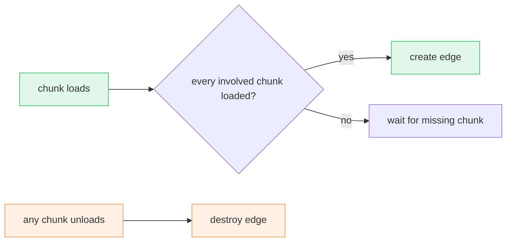

# SDP Doc Conventions

The doc-format contract for the `sdp` skill. A doc is plain Markdown that renders
as-is on GitHub and in editors, with no build step. Diagrams are
Mermaid fenced blocks; an SVG file is the fallback for geometry only.

## File layout

```
docs/
  <domain>/<feature>.md            feature doc (deeper nesting is fine)
  <domain>/<feature>.svg           optional fallback diagram, beside its doc
  <domain>/<feature>-<topic>.svg   a second diagram for the same doc
```

The concrete domain layout is a **per-project fact** (CLAUDE.md → _Design docs_);
the names above are placeholders.

- **Domain-scoped:** a doc lives under the domain matching the code it documents.
- **One feature, one file.** kebab-case; no `-spec` / `-design` / date / version
  suffix.
- **Cross-links** between docs are relative Markdown links:
  `[World Reference Change](world-reference-change.md)`.

## Skeleton

````markdown
# <Feature Name>

*One-line purpose.*

## Problem

2–4 sentences: what the feature does and why it exists.

## Architecture

One or two sentences of orientation, then the diagram(s).

```mermaid
…
```

## Key rules

| Concern | Rule |
|---|---|

## File map

| File | Role |
|---|---|
| `path/to/file.ts` | One-line role. |

<details data-agent="implementation">
<summary>One-line insight the code can't show</summary>

…the non-obvious reasoning or gotcha…

</details>
````

The skeleton is a guide: omit sections a feature doesn't have, and add a
feature-specific section when it earns one (e.g. _Testing_, _How a new entity
hooks in_). Never add change-log or history sections.

## Sections

**Header.** H1 title plus one italic purpose line. No date, status, owner.

**Problem.** 2–4 sentences, the desired state — no "we used to do X".

**Architecture.** A diagram, not prose, unless the feature is a single component
with no internal flow. Put 1–3 sentences before each diagram saying what it shows
and, below it, any note on what the picture can't say (e.g. a component that
deliberately does _not_ take part). Split a flow that needs more than ~6 stages
into separate diagrams or docs.

**Key rules.** Decision matrices, limits, state transitions as tables; one row
per rule, fitting one line where possible. A rule needing a paragraph belongs in a
collapsible.

**File map.** Required when code is attached. Exactly two columns, File and Role;
no status column or change badges. It lists the target-state files that implement
the feature, and only those — it is the anchor the skill uses to find the code.
Tests, generated files, and build artifacts go in collapsibles.

## Diagrams

### Pick by flow shape

| Flow shape | Mermaid type | Notes |
|---|---|---|
| Ordered exchange, call/reply, handshake, feedback edge | `sequenceDiagram` | **Favored** whenever ordering matters; use `alt`/`opt` for branches |
| Pipeline through layers, fan-out from one source, conflict/relationship graph | `flowchart TD` / `LR` | `subgraph` for layers; edge labels for what flows; dotted edge for indirect |
| States that advance and recycle, mode switches | `stateDiagram-v2` | The recycle edge is the point |
| Decision logic | `flowchart` with `{…}` nodes | |
| Relationship that _is_ geometry (grid ownership, adjacency, coordinate frames) | **SVG fallback** | Only when no Mermaid type can show it |

Pick per flow, not per doc; several small diagrams beat one crowded one.

### Mermaid rules

- **Participants only.** Every node takes part in that flow. Non-participants
  (works without subscribing, rejected alternative, mere neighbour) go in prose,
  never a node — even dimmed.
- **Quote labels** that contain punctuation: `A["onMoveTo (L tap)"]`. Use
  `<br/>` for line breaks. Avoid `<`, `>`, and `#` inside labels — write "over" /
  "under" instead (they break the parser, especially in `stateDiagram-v2`).
- **Semantic colours** via `classDef`, declared at the top of the diagram and only
  for the classes used. Light-tinted fill + solid stroke reads in light and dark
  themes; set no text colour.

  | Class | Meaning | Definition |
  |---|---|---|
  | `indigo` | raw input / external source | `fill:#6366f122,stroke:#6366f1` |
  | `teal` | adapter / schema / translator | `fill:#14b8a622,stroke:#14b8a6` |
  | `blue` | orchestrator / manager | `fill:#0ea5e922,stroke:#0ea5e9` |
  | `green` | state holder / created / success | `fill:#22c55e22,stroke:#22c55e` |
  | `orange` | event / signal / teardown | `fill:#fb923c22,stroke:#fb923c` |
  | `violet` | domain entity / external contract | `fill:#a855f722,stroke:#a855f7` |
  | `pink` | output / consumer | `fill:#ec489922,stroke:#ec4899` |
  | `red` | blocked / rejected | `fill:#ef444422,stroke:#ef4444` |
  | `dim` | waiting / de-emphasised (rare) | `fill:#94a3b81a,stroke:#94a3b8,stroke-dasharray:4 3` |

  Apply with `NodeId["label"]:::green`. `sequenceDiagram` and `stateDiagram-v2`
  take no per-node colour — keep them plain.

Example:

````markdown

````

### SVG fallback (geometry only)

Use only when the relationship is spatial and Mermaid would lie. Keep it
diagrammatic, not decorative: it illustrates a rule the prose then states.

- Separate file beside the doc, embedded with alt text and followed by a
  one-line caption saying how to read it:
  ``
- **Self-contained:** `xmlns`, `viewBox`, `role="img"` and `aria-label`, and an
  internal `<style>` block (GitHub renders an SVG image in isolation, so it can't
  inherit anything).
- **Light and dark:** semantic classes, with a `@media (prefers-color-scheme:
  dark)` block for text and any low-contrast strokes. Reuse the palette hexes
  above; no other colours.
- Never embed raw `<svg>` in the Markdown itself.

## Emphasis and status

Markdown has no text colour (renderers strip `style` and `<font>`), so signal
with what survives everywhere:

- **Status in tables:** emoji in the cell — ✅ allowed, ⛔ blocked, 🔇 muted. Keep
  one fixed meaning per emoji within a doc.
- **Gotcha or must-know:** a GitHub alert on its own line —
  `> [!WARNING]` or `> [!NOTE]`, followed by `> text`. Use sparingly; at most one
  or two per doc.
- **Names, files, identifiers:** `code`. **Key term on first use:** **bold**.
- **Colour:** only inside diagrams (Mermaid `classDef` palette, SVG fallback).
  No LaTeX `\color` tricks, no `<span style>`, no coloured badge images.

## Collapsibles — the agent surface

The visible doc is for humans skimming: problem, diagram, rules, file map. Detail
an agent needs to fix or extend the feature goes into a `<details>` block —
GitHub-rendered, collapsed by default (never `open`), tagged
`data-agent="<type>"`, with a one-line `<summary>`. Leave a blank line after
`<summary>` and before `</details>` so the body renders as Markdown.

**Prefer a source reference** to inline detail. The file map names where parts
live; for specific behaviour cite file and symbol inline
(`src/input/manager.rs · resolve_conflict`). A pointer can't drift the way a
paraphrase does.

**Keep a block only for durable insight** the code can't show at a glance:

- a summary replacing a read of many files (test overview, allowed/blocked map);
- non-trivial complexity, or the _why_ behind a design choice;
- a gotcha — ordering constraint, sharp edge, hidden invariant;
- background needed to act safely (threat surface, allocation budget).

Routine detail the code states plainly is **transient scaffolding**: acceptable
only while the code doesn't exist yet, to carry intent to the implementer. Add
`data-transient="true"` beside `data-agent` and remove the block once the code
lands. Litmus test: _would an agent who has read the code and file map still learn
something?_ If not, delete it. A built feature may have zero blocks.

| Tag | Use for |
|---|---|
| `implementation` | non-obvious complexity, invariants, the "why" |
| `test` | coverage map — the shape of the cases, not a restatement of each |
| `security` | threat surface, abuse cases, validation rationale |
| `performance` | hot paths, budgets, profiling targets |
| `accessibility` | requirements and rationale |
| `migration` | one-shot notes (transient) |

Other tags are fine; consistency within a feature matters more than the label.
Keep code in a block to a short anchoring signature; full code lives in the
codebase. Test overviews are tables of `# · Case · Kind`.

## Never in a doc

- **Change-log narrative:** "today vs proposed", "previously did X", "we replaced
  A with B", "no longer". Test: does the sentence make sense to a reader who never
  saw the prior version? If not, it's change-log.
- **Change badges** (`new` / `refactor` / `keep` / `removed`) anywhere.
- **Roadmap content** — unbuilt, unplanned "future" boxes or sections.
- **Dates, status lines, ownership lines** — git carries history.
- **TBD / TODO / placeholders** — resolve first, or record an explicit open
  question in a collapsible.
- **Walls of prose** — a paragraph over ~4 sentences wants a diagram, table, or
  collapsible.
- **Decoration** — emoji outside table status cells, banners, badges, text
  colour hacks (see _Emphasis and status_).

## Self-review checklist

- [ ] `docs/<domain>/<feature>.md`, kebab-case, no suffixes.
- [ ] H1 + italic purpose line; no date, status, or owner.
- [ ] Architecture has a diagram of a type that fits the flow (sequence where
      ordering matters); SVG only for genuine geometry.
- [ ] Every diagram node participates; Mermaid labels quoted, no `<` `>` `#`.
- [ ] Colours come from the semantic palette; SVG files are self-contained with a
      dark-mode block.
- [ ] File map: two columns (File, Role), paths exist (or are explicitly target
      state), no badges.
- [ ] Every `<details>` is collapsed, tagged `data-agent`, and carries durable
      insight; no `data-transient` block whose code now exists.
- [ ] No change-log, badges, roadmap, dates, status lines, TBDs.
- [ ] Read fresh, the doc predicts the code (or, if unbuilt, what the code will be).

## Conformance check

Run before doing the skill's own work: the self-review checklist above plus
file-map-exists-when-code-attached and no stale `data-transient` blocks. The doc on
disk is the only state — there is no resume checkpoint.

**Mechanical** — fix inline without asking: filename suffix (plain rename; say so
in the hand-off so the user stages it), untagged `<details>` (propose a tag from
the table, ask only if the content is mixed), date or status line, unquoted
Mermaid labels, inline `<svg>` moved to a sibling `.svg` file.

**Structural** — fix inline so the doc is readable: change badges, status column
in the file map, change-log paragraphs, roadmap content in a diagram, missing file
map. The exception is a fix that would alter _meaning_ (a "future" section that
might be real intent) — ask first.

Report briefly:

> Conformance check found — Mechanical: <list>, fixing. Structural: <list>, fixing
> (asking first on any that change meaning).
